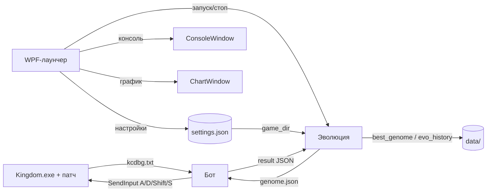

# 02 Архитектура

## Схема данных

## Потоки
1. **Эпизод**: лаунчер → `KCbotEngine` (эволюция) → `GameRestart` (перезапуск игры) → `Bot` (эпизод) → `result JSON` → `Scoring` → отбор.
2. **Ручное обучение**: лаунчер → `KCbotEngine --human-train` → запись (`Recorder`) → `Converter` → `human_genome_*.json`.
3. **Сброс**: `KCbotEngine --resetAll` → удаление истории/генома/baseline/логов/human → пересоздание baseline.

## Ключевые файлы
| Файл | Роль |
|---|---|
| `Kingdom_Data/kcdbg.txt` | состояние игры (огромный, авто-очистка >256 МБ) |
| `Kingdom_Data/speed.txt` | множитель скорости |
| `data/best_genome.json` | лучший геном |
| `data/evo_history.json` | история эволюции |
| `saves/baseline.dat` | сохранение для сброса игры |
| `data/human_genome_*.json` | геномы ручного обучения |
| `%APPDATA%/KCbot/settings.json` | настройки лаунчера |

## Важные ограничения
- Игра получает клавиши только в фокусе → бот использует `SetForegroundWindow` + `AttachThreadInput`.
- `kcdbg.txt` растёт бесконечно → читаем только хвост (256 КБ) и чистим при >256 МБ.
- `SendInput` требует точного размера структуры `INPUT` (40 байт на x64) — иначе клавиши не уходят.

## Связанные заметки
- [[03 Python-движок]]
- [[04 C#-движок (KCbotEngine)]]
- [[11 Логи и диагностика]]
